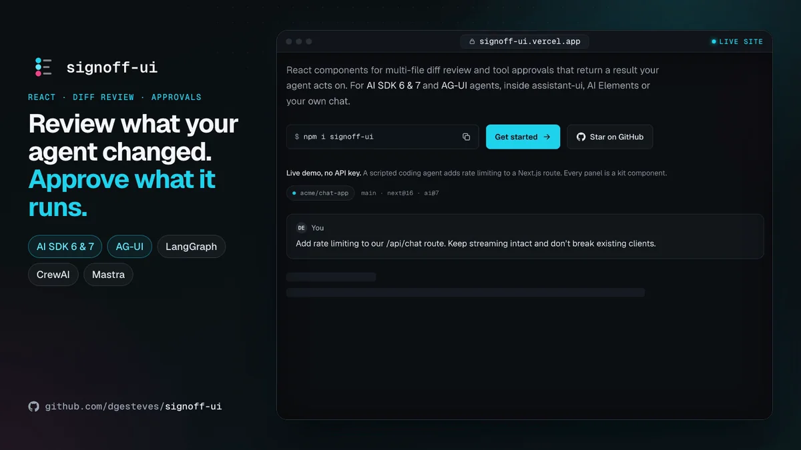

# signoff-ui

Review what your agent changed and approve what it may do: React components for multi-file diff review and tool approvals that return a result your agent acts on, for AI SDK 6 & 7, AG-UI and ACP agents, inside assistant-ui, AI Elements or your own chat.

[](https://github.com/dgesteves/signoff-ui/actions/workflows/ci.yml)
[](https://www.npmjs.com/package/signoff-ui)
[](https://signoff-ui.vercel.app/docs/limits#bundle-size)
[](https://signoff-ui.vercel.app/docs/getting-started#requirements)
[](./LICENSE)

[](https://signoff-ui.vercel.app/docs/getting-started#with-the-shadcn-cli)

**Works with**
[](https://signoff-ui.vercel.app/docs/getting-started#ai-sdk-6-or-7)
[](https://signoff-ui.vercel.app/docs/chat-ui#ai-elements)
[](https://signoff-ui.vercel.app/docs/chat-ui#assistant-ui)
[](https://signoff-ui.vercel.app/docs/ag-ui)
[](https://signoff-ui.vercel.app/docs/acp)

**Website and docs:** [signoff-ui.vercel.app](https://signoff-ui.vercel.app), with a playground where a scripted coding agent asks for a review and an approval, driven from the keyboard, with no API key.

<!-- npm-readme:video -->

https://github.com/user-attachments/assets/caf5f11c-6f12-430b-8b72-845c406ded7a

<sub>The <a href="https://signoff-ui.vercel.app">playground</a>, driven from the keyboard: tool calls stream into the timeline, <kbd>Y</kbd> approves the install, <kbd>A</kbd>/<kbd>R</kbd> review hunks, <kbd>Ctrl</kbd>+<kbd>↵</kbd> applies. Then the <a href="https://signoff-ui.vercel.app/components#ag-ui">AG-UI demo</a>, a real <code>@ag-ui/client</code> agent that resumes once you approve.</sub>

<!-- npm-readme:image
<p align="center">
  <a href="https://signoff-ui.vercel.app"></a>
</p>

<sub>The <a href="https://signoff-ui.vercel.app">playground</a>, driven from the keyboard: tool calls stream into the timeline, <kbd>Y</kbd> approves the install, <kbd>A</kbd>/<kbd>R</kbd> review hunks, <kbd>Ctrl</kbd>+<kbd>↵</kbd> applies. Then the <a href="https://signoff-ui.vercel.app/components#ag-ui">AG-UI demo</a>, a real <code>@ag-ui/client</code> agent that resumes once you approve.</sub>
-->

## Why it exists

Coding and editing agents propose changes across several files and ask to run commands that can break things, and someone has to sign off on both. The chat kits most teams use stop short there: assistant-ui's reviewable diff takes one file's hunks, already split, and its apply returns nothing, while AI Elements has no diff at all and a confirm/deny you wire up yourself. `DiffReview` computes the hunks from each file's old and new contents, lets a person accept or reject them (or whole files) and comment on lines from the keyboard, and gives the agent back each file with only the accepted hunks applied, the hunks it rejected and every comment with its lines. `ApprovalCard` shows exactly what will run and how risky it is, takes a reason with a denial, lets a person approve once, for the session or always (by tool and argument pattern) and edit the arguments first, and tells automatic decisions apart from a person's.

## Quickstart

**Try it without an API key.** The reference app is a coding agent on a scripted model: it asks before it runs a command, and nothing it writes lands until you apply it in a review. One command, nothing to copy:

```bash
npx create-next-app@latest my-agent --example https://github.com/dgesteves/signoff-ui/tree/main/examples/coding-agent
cd my-agent
npm run dev   # http://localhost:3400
```

[examples/nextjs-minimal](examples/nextjs-minimal), the three files below as an app on a scripted model, starts the same way: `npx create-next-app@latest my-quickstart --example https://github.com/dgesteves/signoff-ui/tree/main/examples/nextjs-minimal`.

**Add it to your app.** Install the kit:

```bash
npm i signoff-ui
```

Add the styles once: `@import 'signoff-ui/tailwind.css';` after Tailwind v4 in your CSS, or `import 'signoff-ui/styles.css';` with Tailwind v3 or none. [Your first sign-off](https://signoff-ui.vercel.app/docs/getting-started#your-first-sign-off) then renders an approval card and a review, with no AI SDK and no key.

**Connect an agent.** Install the AI SDK and a model provider with it:

```bash
npm i signoff-ui ai @ai-sdk/react @ai-sdk/openai zod
```

Then add the three files below to a Next.js App Router app (under `src/app/` if your app has a `src` folder). They build as they are, and run with `OPENAI_API_KEY` set. Without Tailwind, the classes on your own elements in them need [this CSS](https://signoff-ui.vercel.app/docs/getting-started#without-tailwind).

**The route.** The agent proposes edits through `review_changes`, a tool with no `execute`, so the page answers it. `toolApproval` makes AI SDK 7 stop and ask before `run_command`:

```ts
// app/api/chat/route.ts
import { openai } from '@ai-sdk/openai';
import type { DiffReviewToolOutput } from 'signoff-ui/core';
import { convertToModelMessages, stepCountIs, streamText, tool, type UIMessage } from 'ai';
import { z } from 'zod';

const tools = {
  // No execute: the page answers it with a DiffReview, and the result holds each file as applied.
  review_changes: tool({
    description: 'Propose edits to files. The user reviews them hunk by hunk before anything is written.',
    inputSchema: z.object({
      files: z.array(z.object({ path: z.string(), oldContent: z.string().optional(), newContent: z.string() })),
    }),
    // What the page sends back: reviewToolOutput(review). Messages typed with InferUITools take it from here.
    outputSchema: z.custom<DiffReviewToolOutput>(),
  }),
  run_command: tool({
    description: 'Run a shell command in the repository.',
    inputSchema: z.object({ command: z.string() }),
    execute: async ({ command }) => ({ exitCode: 0, stdout: `(simulated) ${command}` }),
  }),
};

export async function POST(req: Request) {
  // The messages come from the client as they are: a caller can send an approval for a call the model never
  // proposed. Before a tool has real effects, read "What an approval is":
  // https://signoff-ui.vercel.app/docs/getting-started#what-an-approval-is
  const { messages }: { messages: UIMessage[] } = await req.json();
  const result = streamText({
    model: openai('gpt-5.4-mini'),
    messages: await convertToModelMessages(messages, { tools }),
    tools,
    // Ask before running commands. The reason shows on the approval card.
    toolApproval: { run_command: { type: 'user-approval', reason: 'Runs a shell command in the repository.' } },
    // Keep going after tool calls: the AI SDK stops after the first step by default.
    stopWhen: stepCountIs(10),
  });
  return result.toUIMessageStreamResponse({
    originalMessages: messages,
    // Why a run or a tool call failed, sent to the page. The default hides every error as "An error occurred.".
    // That is the provider's error text, in the browser: return a message of your own in production.
    onError: (error) => (error instanceof Error ? error.message : 'An error occurred.'),
  });
}
```

**The client component.** `AgentMessage` lays out the run with the approval card inline, and `renderTool` puts a `DiffReview` where the proposed edit is. Its `onSubmit` result goes back to the agent as the tool's output, through `reviewToolOutput`: a summary, each file as applied, the hunks rejected and the reviewer's comments. The run continues once every answer is in. When a request fails, `error` says why, such as a missing API key:

```tsx
// app/agent-run.tsx
'use client';

import { useChat } from '@ai-sdk/react';
import { lastAssistantMessageIsCompleteWithApprovalResponses, lastAssistantMessageIsCompleteWithToolCalls } from 'ai';
import { useState } from 'react';
import {
  AgentMessage,
  AgentStatus,
  DiffReview,
  deriveAgentState,
  getToolPartName,
  reviewToolOutput,
  type FileChange,
} from 'signoff-ui';

export function AgentRun() {
  const { messages, status, error, sendMessage, addToolOutput, addToolApprovalResponse } = useChat({
    // Continue the run once the review is in and every approval has an answer.
    sendAutomaticallyWhen: (chat) =>
      lastAssistantMessageIsCompleteWithToolCalls(chat) || lastAssistantMessageIsCompleteWithApprovalResponses(chat),
  });
  const [input, setInput] = useState('');
  const last = messages.findLast((m) => m.role === 'assistant');
  // review_changes waits on a person, like an approval.
  const { state, detail } = deriveAgentState({ status, message: last, pendingClientTools: ['review_changes'] });

  return (
    // The kit's own background and text colors, so it reads well on any page. Add `dark` for the dark theme.
    <div className="bg-signoff-bg text-signoff-fg mx-auto flex w-full max-w-2xl flex-col gap-4 p-6">
      <AgentStatus state={state} detail={detail} />
      {/* Why the run failed, such as a missing API key: the route's onError sends the message. */}
      {error && <p role="alert">{error.message}</p>}
      {last && (
        <AgentMessage
          message={last}
          streaming={status === 'streaming'}
          // Once the run has finished, been stopped or failed, calls that never settled read "Stopped".
          active={state !== 'done' && state !== 'stopped' && state !== 'error'}
          failed={status === 'error'}
          onToolApproval={addToolApprovalResponse}
          // The proposed edit, reviewed hunk by hunk: the agent gets the files as applied, and your comments.
          renderTool={(part) =>
            getToolPartName(part) === 'review_changes' && part.state === 'input-available' ? (
              <DiffReview
                files={(part.input as { files: FileChange[] }).files}
                onSubmit={(review) =>
                  addToolOutput({
                    tool: 'review_changes',
                    toolCallId: part.toolCallId,
                    output: reviewToolOutput(review),
                  })
                }
              />
            ) : undefined
          }
        />
      )}
      <form
        className="flex gap-2"
        onSubmit={(event) => {
          event.preventDefault();
          if (!input.trim()) return;
          void sendMessage({ text: input });
          setInput('');
        }}
      >
        <input
          aria-label="Message the agent"
          value={input}
          onChange={(event) => setInput(event.target.value)}
          className="border-signoff-border bg-signoff-surface flex-1 rounded-lg border px-3 py-2 text-sm"
        />
        <button
          type="submit"
          disabled={status !== 'ready' && status !== 'error'}
          className="bg-signoff-accent text-signoff-on-accent rounded-lg px-4 text-sm font-medium disabled:opacity-50"
        >
          Send
        </button>
      </form>
    </div>
  );
}
```

**Render it from a page.** Put it inside `<Suspense>`, which `useChat` needs in new Next.js 16 apps:

```tsx
// app/page.tsx
import { Suspense } from 'react';
import { AgentRun } from './agent-run';

export default function Page() {
  // With cacheComponents (on in new Next.js 16 apps), useChat needs a Suspense boundary:
  // it creates ids with Math.random(), which Next.js does not allow in prerendered output.
  return (
    <Suspense>
      <AgentRun />
    </Suspense>
  );
}
```

[Getting started](https://signoff-ui.vercel.app/docs/getting-started) walks through it, including AI SDK 6, other models, typed messages, [what an approval is](https://signoff-ui.vercel.app/docs/getting-started#what-an-approval-is) and the shadcn registry (`npx shadcn@latest add https://signoff-ui.vercel.app/r/diff-review.json`). [examples/nextjs-minimal](examples/nextjs-minimal) adds a cost meter, the run's timing and a `read_file` tool, and CI drives it in Chrome through the review, the approval and the final answer.

## Works inside assistant-ui, AI Elements or your own chat

The components take AI SDK message parts and plain props, not a runtime, and `styles.css` styles only their own elements, never the rest of your page or the content you render inside them.

- **Your own chat:** render `AgentMessage` for the assistant's message, as above, or only `DiffReview` and `ToolApprovalCard` for the tool parts you want to gate. If you already render Markdown with Streamdown or your own renderer, pass it as `renderMarkdown` and import `AgentMessage` from `signoff-ui/custom-markdown`, which leaves react-markdown out of your bundle. Your renderer then has to restrict images itself, as `allowedImageHosts` does for the built-in one.
- **AI Elements:** keep its conversation, messages and prompt input, and render `ToolApprovalCard` or `DiffReview` for those tool parts in place of `Tool` and `Confirmation`.
- **assistant-ui:** `signoffTools()` from `signoff-ui/assistant-ui` goes in `MessagePrimitive.Parts`' `components.tools`: a `DiffReview` for the calls that propose files, its review sent back as the call's result, and the approval card, with your approval rules, for calls at an approval gate. The app `npx assistant-ui create` makes has no `components.tools` and puts tool calls in a group that starts closed: there, register the kit's tool UIs as standalone toolkit entries ([In the assistant-ui starter](https://signoff-ui.vercel.app/docs/chat-ui#in-the-assistant-ui-starter)). [examples/assistant-ui](examples/assistant-ui) runs it with no API key. It needs `@assistant-ui/react` 0.15 or later, an optional peer dependency that npm checks whenever assistant-ui is installed: on an older version, upgrade it, or install with `npm i signoff-ui --legacy-peer-deps` if you use only the other components.
- **AG-UI agents** (LangGraph, CrewAI, Mastra and others): `useAgUiAgent` from `signoff-ui/ag-ui` turns the run into the same message parts, with interrupts as approval cards.
- **Agent Client Protocol:** `signoff-ui/acp` folds a prompt turn's session updates and permission requests into the same message parts, and each edit's diff into `DiffReview` files. The approval card offers Always only when the agent sent a single `allow_always` option: when the agent sends several options of one kind, that kind gets no button (Deny excepted), and answering with it cancels the request rather than picking a grant for the person.

[Inside your chat UI](https://signoff-ui.vercel.app/docs/chat-ui) has the code for each.

## Components

| Role    | Component                                               | What it does                                                                                                                                                                                                                                                                                                                                                                                                                                                          |
| ------- | ------------------------------------------------------- | --------------------------------------------------------------------------------------------------------------------------------------------------------------------------------------------------------------------------------------------------------------------------------------------------------------------------------------------------------------------------------------------------------------------------------------------------------------------- |
| Review  | `DiffReview`, `useDiffReview`                           | Unified or split review of edits across files, computed from their contents or a patch, with word-level highlights. Accept or reject hunks or whole files and comment on lines from the keyboard; `onSubmit` returns each file with only the accepted hunks applied, the rejected hunks and the comments, and `toPatch()` a unified diff. Large files are diffed in a worker and render only what is near the screen. `useDiffReview` is the same without the markup. |
| Approve | `ApprovalCard`, `ToolApprovalCard`, `useApprovalPolicy` | What will run, its risk when you rate it, approve or deny with a reason, a second press for `critical` actions, and "Auto-approved" or "Blocked by policy" for automatic decisions. Approve once, for the session or always, by tool and argument pattern; edit the arguments first; approve all pending; an audit trail; the same rules as AI SDK 7's `toolApproval`.                                                                                                |

**Supporting:** `AgentMessage` renders the rest of an assistant message around them: streaming markdown and reasoning, sources, and every tool call in one timeline (`ToolCallTimeline`) with measured durations, approvals inline and sub-agents nested under the call that started them. `Markdown`, `Reasoning` and `Sources` also work on their own, `RunMeter` prices the run's tokens, `AgentStatus` announces its state, and `useAgUiAgent` turns an AG-UI agent's run into AI SDK messages.

Typed against AI SDK 6 and 7 (`ai@^6.0.0 || ^7.0.102`), on React 18 and 19 (`react@^18.2.0 || ^19.0.0`), with Tailwind v4, v3 or no Tailwind, each tested in CI. Keyboard-first and announced to screen readers, with axe checks in jsdom and in Chrome. Every word the components show or announce is a label you can translate, from one provider. The kit calls no model and makes no requests of its own, so any model your backend uses works.

## Docs

- [Live playground](https://signoff-ui.vercel.app): a scripted coding-agent run with a review and an approval, driven from the keyboard. No API key.
- [Coding agent](examples/coding-agent), the reference app: approval rules, reviews whose comments go back to the agent, and a scripted model, so no API key.
- [Docs](https://signoff-ui.vercel.app/docs): [Getting started](https://signoff-ui.vercel.app/docs/getting-started), [Inside your chat UI](https://signoff-ui.vercel.app/docs/chat-ui), [AG-UI agents](https://signoff-ui.vercel.app/docs/ag-ui), [theming](https://signoff-ui.vercel.app/docs/getting-started#theming), [accessibility](https://signoff-ui.vercel.app/docs/accessibility), [labels and translations](https://signoff-ui.vercel.app/docs/labels), [performance and limits](https://signoff-ui.vercel.app/docs/limits), and a page per component with its props, keyboard and styling hooks. Also as [`/llms.txt`](https://signoff-ui.vercel.app/llms.txt) and [`/llms-full.txt`](https://signoff-ui.vercel.app/llms-full.txt) for coding agents.
- Formerly `@dgesteves/agent-ui-kit`: [Migrating](https://signoff-ui.vercel.app/docs/migrating-from-agent-ui-kit) is a package swap and one command.
- [Changelog](packages/signoff-ui/CHANGELOG.md), [contributing](CONTRIBUTING.md) and [security](SECURITY.md).

## How it compares

signoff-ui does one part of an agent product in depth: the review and approval step. [assistant-ui](https://github.com/assistant-ui/assistant-ui) and [AI Elements](https://github.com/vercel/ai-elements) cover the whole chat, [@pierre/diffs](https://diffs.com) renders diffs, and each does some things better:

- **assistant-ui** has a chat runtime and thread, adapters for the AI SDK, LangGraph, AG-UI and more, and an Elements collection far wider than this kit.
- **AI Elements** covers the most of the message surface in shadcn style (conversation, prompt input, artifacts, a `Context` usage indicator and more), maintained by Vercel. Its components are written against AI SDK 6.
- **@pierre/diffs** renders diffs with Shiki's highlighting, comment annotations, virtualization and a helper to accept or reject a hunk, and leaves the review to you. Its `MultiFileDiff` (1.5.2) is 139 kB gzipped before it loads a Shiki theme or grammar; `DiffReview` is 43.5 kB up front, plus a 6.7 kB worker it starts for large files.

Where signoff-ui goes further: review from file contents across several files, with the patched files, the rejected hunks and line comments as the result; approvals once, for the session or always, by tool and argument pattern, with the arguments editable first and the same rules for AI SDK 7's `toolApproval`; approvals that tell a person's decision from a policy's; tool durations that leave out time spent waiting for a person; and a stylesheet for Tailwind v3 or no Tailwind. Use either chat kit for the chat, and these components for the sign-off. [The full comparison](https://signoff-ui.vercel.app/docs/comparison).

## License

[MIT](./LICENSE) © Diogo Esteves
